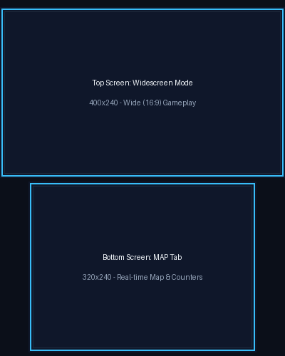
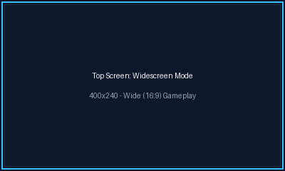
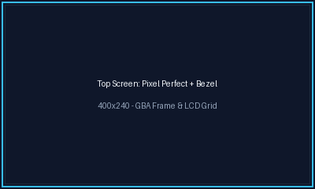
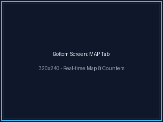
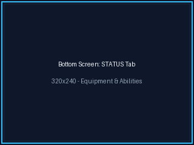
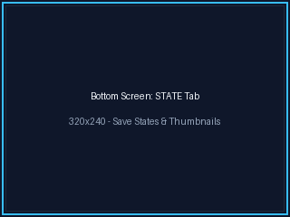
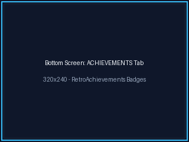
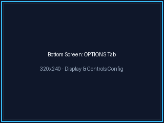

# Metroid: Zero Mission — Nintendo 3DS Port

<p align="center">
  
</p>

A native, hardware-accelerated Nintendo 3DS port of **Metroid: Zero Mission**, built from the C decompilation codebase.

One build works with the **EUR, USA or JAP** ROM: the region is detected when the ROM is loaded and the game adapts at runtime.

---

## Screenshots

<p align="center">
  <b>Top Screen: Widescreen vs. Pixel Perfect + GBA Frame</b><br>
  
  &nbsp;&nbsp;
  
</p>

<p align="center">
  <b>Bottom Screen: Touch Interfaces</b><br>
  
  &nbsp;
  
  &nbsp;
  
  <br><br>
  
  &nbsp;
  
</p>

---

## Features

### Top screen

- **60 FPS gameplay**, rendered by a custom PICA200 GPU renderer (`citro3d`/`citro2d`) for background tiles and sprites, with an automatic per-frame CPU fallback when the scene uses GBA PPU effects the GPU path does not cover (affine backgrounds, windows, mosaic).
- **Stereoscopic 3D** driven by the console's 3D slider, with multi-layer depth (HUD, platforms, Samus, background scenery).
- **Aspect ratio**: `WIDE` (true widescreen extending visible room bounds without stretching), `ORIGINAL` (3:2 or 1:1), or `STRETCH` (16:9).
- **Display style**: `PIXEL PERFECT` (1:1 pixel mapping), `SCALED` (sharp scaling), or `BLUR` (smooth linear filtering).
- **GBA LCD Filters**: Optional retro post-processing shaders configurable from `OFF` to `HIGH`:
  - **GBA COLOR**: Authentic color correction to balance out original GBA brightness boosts.
  - **GBA GRID**: 1-pixel dark scanlines and vertical LCD grille emulation.
  - **VIGNETTE**: Smooth outer-edge darkening.
- **GBA Bezel (Frame)**: Nostalgic Game Boy Advance border surrounding the display in `PIXEL PERFECT` mode, with lateral decorative strips in `SCALED ORIGINAL`.
- **Customizable HUD Position**: Option to position the HUD in the top border area outside the 240x160 active viewport (`TOP BORDER` vs `DEFAULT`) in Pixel Perfect mode.
- **Frame pacing**: Selectable between `ADAPTIVE` (dynamic 30–60 FPS pacing) and `LOCK 30`.
- Optional multi-corner FPS counter and an auto-hide HUD option.

### Bottom screen

Five touch tabs (a sixth, `DEBUG`, only exists in debug builds):

- **MAP** — The area map in real time with zoom levels, browsing other areas with `<` / `>`, a follow-Samus toggle, and collectibles counts for the area being viewed.
- **STATUS** — Beams, bombs, suits and abilities, total item collection percentage, and downloaded map stations, localized into the game's seven languages. Tapping the item line opens a collectibles breakdown per area (Energy Tanks, Missiles, Super Missiles, Power Bombs), which can be spoiler-hidden.
- **STATE** — Full-state save management (save states) with an open-ended slot list, room name, in-game stats, timestamp, and visual screenshot thumbnails. Supports instant save, load, overwrite, and delete.
- **ACHIEVEMENTS** — Dedicated RetroAchievements interface with unlock progress, timestamps, and on-demand badge art cached to the SD card. Direct access to account login and hardcore mode via the *SETTINGS* modal.
- **OPTIONS** — Display settings modal (aspect, filters, frame, pacing), button remapping modal, in-app updater (*UPDATES*) with release notes viewer, and soft/hard reset buttons.

### Other

- **In-App Updater**: Check for updates and download/install new CIA releases directly on the console over Wi-Fi. Features a **WHAT'S NEW** release notes viewer to inspect changes before upgrading.
- **RetroAchievements**: Optional login, achievement list with badges, and a hardcore mode, built on [rcheevos](https://github.com/RetroAchievements/rcheevos). The game is identified by the ROM's hash, so each region resolves to its own achievement set. Talks to `retroachievements.org` directly over the console's HTTP service, so it needs a network connection and an account.
- **Native audio** through the decompiled MZM sound engine, output on the 3DS DSP (NDSP).
- **Console optimization**: New 3DS 804 MHz CPU boost and L2 cache when available, plus frame pacing for Old 3DS and 2DS.
- **Settings and save data**: All saves, states, cached badges, and configuration files live next to the ROM on the SD card, not inside the app.

---

## Controls

Default mapping:

| Button | Action |
|---|---|
| A | Jump |
| B | Fire |
| X | Rapid fire (auto-fire while held) |
| Y | Quick morph (toggle Morph Ball in one press) |
| L / ZL | Aim |
| R / ZR | Arm missiles |
| Start | Pause |
| Select | Missiles |
| D-Pad / Circle Pad | Movement and aiming |

All ten buttons are remappable from **OPTIONS → CONTROLS**, to any of: `RAPID FIRE`, `QUICK MORPH`, `FIRE (B)`, `JUMP (A)`, `MISSILES (SELECT)`, `AIM (L)`, `ARM WEAPON (R)`, `PAUSE (START)` or `NONE`.

The C-Stick / New 3DS right analog can be set to `OFF`, aiming only (up/down), movement only (left/right), or all four directions.

Two extras beyond the original game:

- **Aiming with the mapped Aim button also enables diagonal aim**, which the GBA game cannot do.
- **Soft reset** works with the retail combo `A + B + Start + Select` and also with `L + R + Start + Select`.

---

## Installation

1. **Install the app**

   Download `mzm-3ds.cia` from the [Releases page](https://github.com/tinaut1986/mzm/releases)
   and install it with FBI or your preferred installer. Releases named **Beta**
   are pre-releases cut from a branch still being worked on; pick a plain
   **Release** for a stable build.

   Only a CIA is published. A `.3dsx` cannot declare its own memory budget, so
   it inherits whatever the Homebrew Launcher's host title has left — not enough
   for the 8&nbsp;MB ROM buffer plus the GPU buffers this port reserves. The CIA
   requests 64&nbsp;MB of its own.

2. **ROM placement**

   Create this directory and copy a clean, legally obtained GBA ROM into it. Any `.gba` filename works:

   ```text
   sdmc:/3ds/Metroid Zero Mission 3DS/
   ```

   | Region | Game code | SHA-1 |
   |---|---|---|
   | Europe | `BMXP` | `0fd107445a42e6f3a3e5ce8c865f412583179903` |
   | USA | `BMXE` | `5de8536afe1f0078ee6fe1089f890e8c7aa0a6e8` |
   | Japan | `BMXJ` | `096f07685a3dc9286e71aa0b761f233b5efa2fcd` |

   > **Note:** While all three region ROMs are verified to work and supported, the port was primarily developed and playtested from start to finish on real hardware using the **European (EUR)** version.

   If several region ROMs are present, the port picks one deterministically — **EUR first, then USA, then JAP**, and the alphabetically first filename within a region. Keep only the ROM you want to play, or rename the others.

   The ROM is read from the SD card at run time and is never packaged inside the executable.

3. **Audio setup**

   Dump your console's DSP firmware, or there will be no sound. On Luma3DS: `L + Down + Select` to open the Rosalina menu → *Miscellaneous options* → *Dump DSP firmware*.

### Files the port creates

Everything lives inside the game folder (`sdmc:/3ds/Metroid Zero Mission 3DS/`); nothing is written to the SD root or elsewhere in `/3ds`:

- `mzm.sav` — the save file. It is shared by every region: if you switch ROMs, a language that the new ROM does not have is clamped to that region's default on load.
- `mzm3ds.ini` — settings (display, button mapping, C-Stick mode, bottom-screen state, RetroAchievements).
- `states/` — save states and visual thumbnails.
- `badges/` — cached achievement badge icons downloaded on-demand from RetroAchievements.
- `debug/` — logs (debug, RetroAchievements) and debug-menu captures (perf, scene recorder, dumps). Only appears in use with the logging/debug tools.
- `update/` — the CIA downloaded by the in-app updater (removed after a successful install).

---

## Building

### Requirements

- [devkitPro](https://devkitpro.org/) with `devkitARM`, `libctru`, `citro2d` and `citro3d`.
- 3DS portlibs used by the self-updater: `3ds-curl`, `3ds-mbedtls`, `3ds-zlib` (`dkp-pacman -S 3ds-curl 3ds-mbedtls 3ds-zlib`).
- `makerom` and `bannertool` for `.cia` packaging.

### Build commands & Helper Scripts

We provide interactive and automated scripts for Linux and Windows:

- **Linux / macOS**:
  ```sh
  ./build_3ds.sh              # Launches the interactive arrow-key build assistant
  ./build_3ds.sh --mode prod  # Builds production CIA package
  ./build_3ds.sh --ftp 192.168.1.50 # Builds and uploads via FTP (defaults to debug mode)
  ```
- **Windows**:
  ```cmd
  build_3ds.bat               # Launches the interactive build assistant
  build_3ds.bat --mode prod   # Builds production CIA package
  build_3ds.bat --ftp 192.168.1.50
  ```

Alternatively, you can invoke `make` directly:

```sh
cd platform/3ds
make clean && make -j$(nproc)
```

Outputs land in `platform/3ds/`: `mzm-3ds.cia` and `mzm-3ds.elf`. The `cia` and
`elf` targets build just one of them. There is also a `3dsx` target, but it is
not built by default and not distributed — see the installation note above.

### Tools: Layer Workbench

An in-browser visual inspection and tuning tool for the port's stereoscopic 3D layers:

- **Linux / macOS**: `./run_workbench.sh`
- **Windows**: `run_workbench.bat`

Runs a local web server at `http://127.0.0.1:8731/` and opens your browser. It includes three modes:
- **MAP**: Inspect any of the game's 315 rooms layer-by-layer (BG0–BG3) and adjust block depths, syncing automatically to `platform/3ds/source/port_layer_fixes.inc`.
- **SPRITES**: Visual catalogue of all primary and secondary sprites with thumbnails to configure forced 3D depth tiers (`platform/3ds/source/port_sprite_depth.inc`).
- **REC**: Inspect on-device scene recording dumps (`mzm-rec.bin`) frame-by-frame.

See [tools/layer-workbench/README.md](tools/layer-workbench/README.md) for full usage instructions and shortcuts.

### Tools: Screenshot Processing

Helper script to convert raw console dumps or Luma3DS screenshots to web-ready PNGs for the repository:

```sh
python3 tools/process_screenshots.py --placeholders
python3 tools/process_screenshots.py --import-dir /path/to/dumps_or_screenshots/
```

See [screenshots/README.md](screenshots/README.md) for full import instructions and expected dimensions.

### Region

`REGION=any` is the default and produces the single binary described above. The other values pin the decomp's compile-time region choices, which also restricts that build to one region's ROM — useful for bisecting a region-specific problem:

```sh
make REGION=any        # one binary for EUR/USA/JAP (default)
make REGION=eu         # or us, jp
```

### Debug tools

```sh
make clean && make DEBUG_TOOLS=1
```

Adds the bottom-screen `DEBUG` tab and its touch-activated diagnostic tools menu (screen/state dump, scene recorder, atlas dump, log mark, instant kill, warp, equipment editor). Production builds have no source-level path to them.

For renderer selection, diagnostics flags and the rest of the build options, see [platform/3ds/README.md](platform/3ds/README.md).

---

## Known issues

- Sound is silent until the DSP firmware is dumped (see Installation).
- Behavioural differences against the original game are collected in [KNOWN_DIFFERENCES.md](KNOWN_DIFFERENCES.md).

---

## Credits & Acknowledgments

This port is made possible thanks to the work of multiple open-source projects:

- **[metroidret/mzm](https://github.com/metroidret/mzm)** — The decompilation project of *Metroid: Zero Mission*, providing the reverse-engineered C source code.
- **[EstebanPdN / zelda-tmc-3ds](https://github.com/EstebanPdN/zelda-tmc-3ds)** — The Nintendo 3DS port of *The Minish Cap*, whose platform architecture, 3DS frontend implementation, and Citro2D/Citro3D presentation pipeline served as the initial foundation for this port.
- **[devkitPro](https://devkitpro.org/)** — For providing the homebrew toolchain, `libctru`, `citro2d`, and `citro3d`.
- **VirtuaPPU** by Mathéo Vignaud — Upstream base for the software GBA Picture Processing Unit.
- **[RetroAchievements](https://retroachievements.org/)** — For the achievement set and the API this port talks to.

---

## License

This project is licensed under the terms of the GNU General Public License v3.0 (GPL-3.0-or-later). See [LICENSE](LICENSE) for the full license text and [THIRD-PARTY-LICENSES.md](THIRD-PARTY-LICENSES.md) for upstream and third-party notices and attributions.
