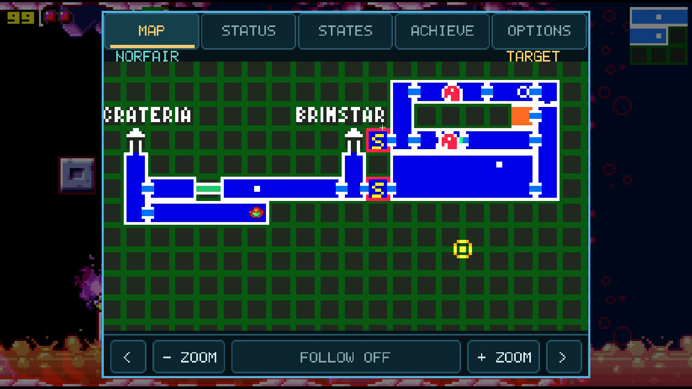
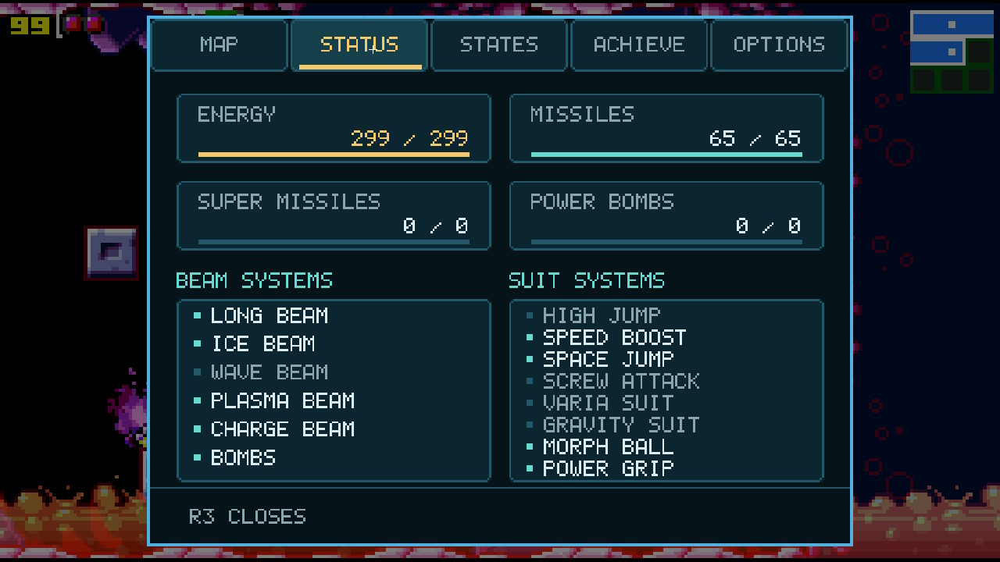
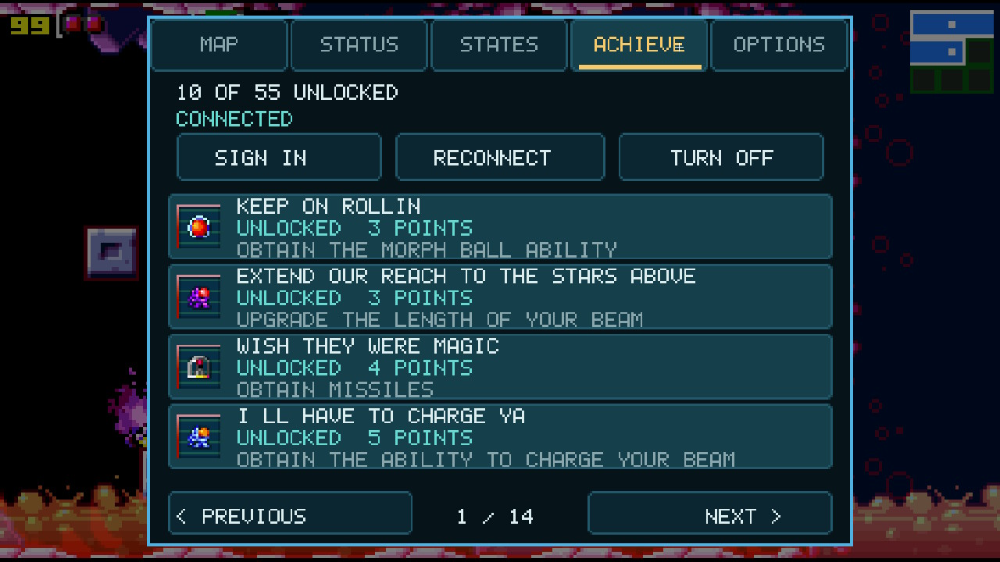
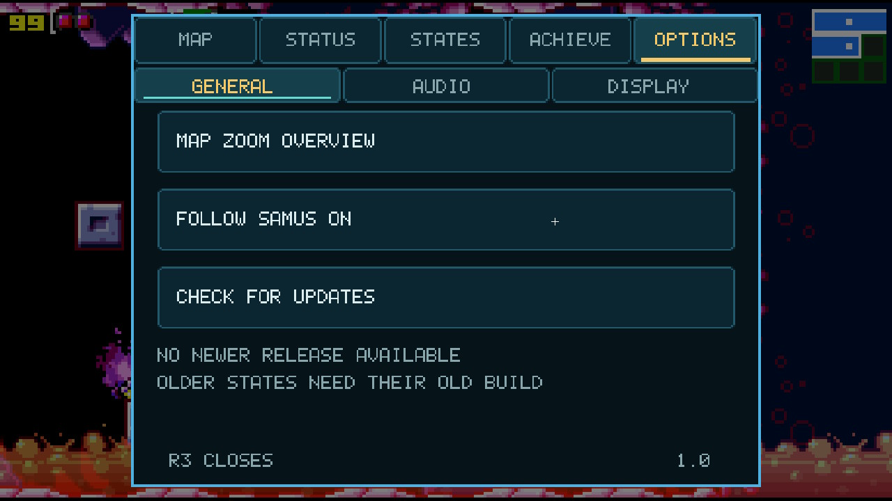
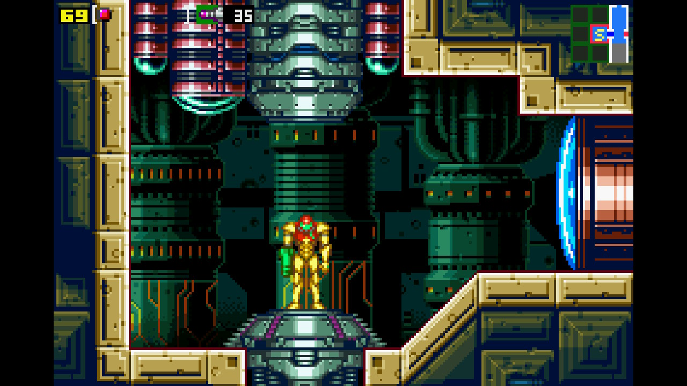
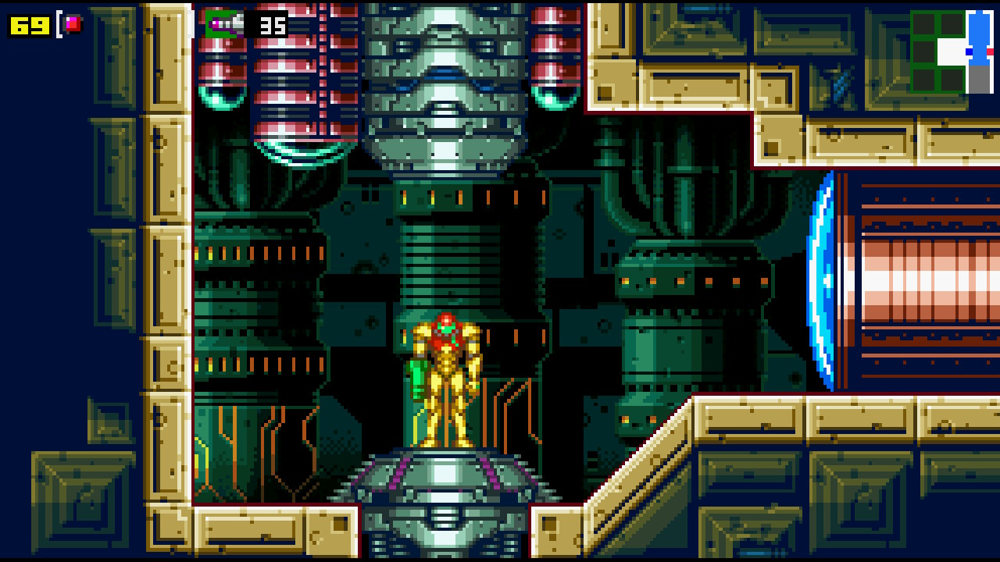

 Metroid: Zero Mission NX

An unofficial native Nintendo Switch homebrew port of **Metroid: Zero Mission**, adapted from [tinaut1986/mzm](https://github.com/tinaut1986/mzm), which builds on [metroidret/mzm](https://github.com/metroidret/mzm).

**Switch maintainer:** JJTapia_XX · **Version:** 1.2 · **Status:** community release

This is a community project, unaffiliated with Nintendo. You must supply your own compatible GBA ROM dump. No ROM is included or provided for download.

## AI-assisted development

AI tools, including OpenAI Codex, were used to help develop this Nintendo Switch adaptation, debug issues, and write documentation. JJTapia_XX directed the changes and tested builds on Switch hardware.
AI assistance does not replace or diminish the work of the original developers and contributors. Their credits, copyright notices, and licenses are preserved.
This is an experimental community project. AI-assisted changes may contain errors; please report issues through this repository.

## Features

- Native game logic, software GBA rendering, and native audio.
- Centered Wide scale with additional room visibility on both sides; original-size menus and cutscenes.
- Three display layouts: R3 Second Screen Popup, Side by Side, and clockwise Flip Grip.
- Touch map using the original pause-menu assets loaded from your ROM, with zoom, Follow, and active objective markers.
- In-app GitHub updater with verified downloads and an NRO backup.
- Dedicated Map, Status, States, Achievements, and Options tabs, with polished panels and centered save-state labels.
- Audio and display settings; saved master volume defaults to 50%, with gain up to 150%.
- Five save-state slots, alongside normal in-game saves.
- Optional Softcore RetroAchievements with offline caching, queued sync, badges, and unlock notifications.

## Second-screen preview

| Map | Status |
| --- | --- |
|  |  |

| Achievements | Options |
| --- | --- |
|  |  |

## Normal and Wide comparison

Wide reveals extra scenery on both sides instead of stretching the original image. The HUD stays anchored to the screen edges.

| Normal | Wide |
| --- | --- |
|  |  |

## Install

1. Download the installation ZIP from this repository's Releases page.
2. Extract it to the root of your Switch SD card. The application belongs at `switch/mzm/mzmnx.nro`.
3. Copy your own Metroid: Zero Mission GBA ROM dump to `switch/mzm/mzm.gba`.
4. Launch through your homebrew environment. USA ROMs have been used for testing; other regions have not been verified for this Switch adaptation.

Read [Switch instructions](platform/switch/README.md) for controls, builds, settings, and known limitations. The [original 3DS README](README-3DS.md) is preserved for upstream documentation; its features and installation instructions apply to the 3DS port.

## Credits

This Switch adaptation is maintained by **JJTapia_XX**. It depends on substantial work by:

- **tinaut1986** — upstream 3DS port and shared native-port infrastructure.
- **metroidret/mzm contributors**, including **YohannDR** — the decompilation project.
- **EstebanPdN / zelda-tmc-3ds** — original platform/frontend foundation used by the upstream port.
- **Mathéo Vignaud / VirtuaPPU** — software GBA rendering foundation.
- **devkitPro and switchbrew/libnx** — Switch toolchain and platform libraries.
- **RetroAchievements contributors and rcheevos** — achievement definitions, service, runtime, and parsers.
- **Sean Barrett and stb contributors** — PNG decoding.

See [CREDITS.md](CREDITS.md) and [THIRD-PARTY-LICENSES.md](THIRD-PARTY-LICENSES.md). Original copyright and license notices are retained. The NRO's Author field identifies the Switch maintainer; it does not replace these credits or imply sole authorship of the project.

## License and game assets

The combined port retains the upstream **GPL-3.0-or-later** licensing statement and [LICENSE](LICENSE), with component-specific notices retained. Release binaries are accompanied by corresponding source and build instructions.

This software license does not grant rights to Nintendo's game, trademarks, cover artwork, or independently authored achievement badge artwork. Those rights remain with their respective owners. The supplied cover artwork's original artist/license has not been independently established; do not describe it as original work by the Switch maintainer or as GPL-licensed. No claim is made that an attribution alone grants permission to redistribute third-party artwork.

## Support and privacy

Include the build revision and steps to reproduce a bug. Crash and connection logs can help, but review them before sharing. Never upload your ROM, saves, save states, `ra-account.cfg`, authentication tokens, or account cache. Achievement sign-in tokens are stored on your SD card and should remain private.

## Current limitations

Testing includes local regression tests and iterative reports from a Switch owner; no full playthrough or complete hardware compatibility matrix is claimed. Save states require the exact build and ROM. RetroAchievements supports Softcore only; Hardcore, leaderboards, and subsets are not implemented. The first Hardcore-warning entry is hidden from the player list. Downloaded badges need connectivity once before they are cached.
